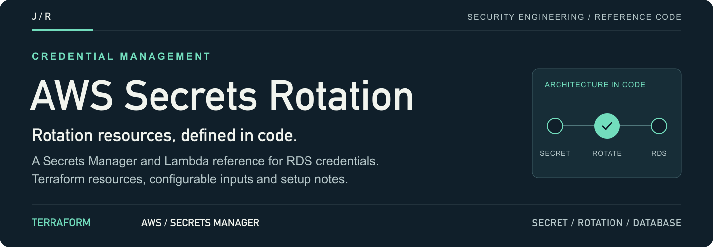
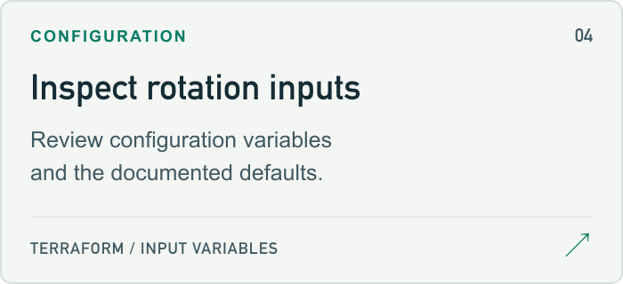

<a id="aws-secrets-rotation-with-lambda"></a>

<a href="#setup-guide">
<picture>
  <source media="(max-width: 600px)" srcset="docs/assets/readme/header-mobile.png">
  
</picture>
</a>

<p>
  <a href="#setup-guide"><strong>Start here ↗</strong></a> &nbsp; / &nbsp;
  <a href="main.tf">Source</a> &nbsp; / &nbsp;
  <a href="#project-guide">Project guide</a> &nbsp; / &nbsp;
  <a href="https://github.com/jmragsdale">Profile</a>
</p>

A Terraform reference for AWS Secrets Manager and Lambda rotation resources for RDS credentials, with configuration and setup notes.

## Explore the project

Open a card for source, examples or supporting documentation.

<p>
<a href="#architecture-guide">
<picture>
  <source media="(prefers-color-scheme: dark)" srcset="docs/assets/readme/architecture-dark.png">
  
</picture>
</a>
<a href="main.tf">
<picture>
  <source media="(prefers-color-scheme: dark)" srcset="docs/assets/readme/source-dark.png">
  
</picture>
</a>
<a href="#setup-guide">
<picture>
  <source media="(prefers-color-scheme: dark)" srcset="docs/assets/readme/setup-dark.png">
  
</picture>
</a>
<a href="variables.tf">
<picture>
  <source media="(prefers-color-scheme: dark)" srcset="docs/assets/readme/inputs-dark.png">
  
</picture>
</a>
</p>

## Project guide

🔐 Automated secrets rotation for RDS credentials using AWS Secrets Manager and Lambda with Terraform IaC

## Overview

This project implements automated secrets rotation for RDS database credentials using AWS Secrets Manager and Lambda. It follows security best practices by ensuring credentials are rotated on a configurable schedule, reducing the risk of credential compromise.

### Security Features

- **Automatic rotation** every 30 days (configurable)
- **Zero-downtime rotation** using multi-user rotation strategy
- **Encrypted secrets** at rest using AWS KMS
- **Least-privilege IAM** roles for Lambda execution
- **VPC integration** for secure database connectivity
- **CloudWatch logging** for audit trails

<a id="architecture-guide"></a>

## Architecture

<details>
<summary>Architecture flow (text)</summary>

```
┌─────────────────────────────────────────────────────────────────┐
│                         AWS Account                             │
│  ┌──────────────────┐    ┌──────────────────┐                   │
│  │  Secrets Manager │───▶│  Lambda Function │                   │
│  │  (RDS Creds)     │    │  (Rotation)      │                   │
│  └────────┬─────────┘    └────────┬─────────┘                   │
│           │                       │                             │
│           │    ┌──────────────────┼──────────────────┐          │
│           │    │     VPC          │                  │          │
│           │    │  ┌───────────────▼───────────────┐  │          │
│           │    │  │      Private Subnet           │  │          │
│           │    │  │  ┌─────────────────────────┐  │  │          │
│           └────┼──┼─▶│      RDS Instance       │  │  │          │
│                │  │  └─────────────────────────┘  │  │          │
│                │  └───────────────────────────────┘  │          │
│                └─────────────────────────────────────┘          │
│  ┌──────────────────┐    ┌──────────────────┐                   │
│  │    KMS Key       │    │   CloudWatch     │                   │
│  │  (Encryption)    │    │   (Logs)         │                   │
│  └──────────────────┘    └──────────────────┘                   │
└─────────────────────────────────────────────────────────────────┘
```

</details>

## Prerequisites

- AWS CLI configured with appropriate permissions
- Terraform >= 1.0
- An existing VPC with private subnets (or use the included simple VPC)

<a id="setup-guide"></a>

## Quick Start

```bash
# Clone the repository
git clone https://github.com/jmragsdale/aws-secrets-rotation-terraform.git
cd aws-secrets-rotation-terraform

# Initialize Terraform
terraform init

# Review the plan
terraform plan -var="db_password=YourSecurePassword123!"

# Apply the configuration
terraform apply -var="db_password=YourSecurePassword123!"
```

## Configuration

| Variable | Description | Default |
|----------|-------------|---------|
| `project_name` | Project name for resource naming | `secrets-rotation` |
| `environment` | Environment (dev/staging/prod) | `dev` |
| `rotation_days` | Days between secret rotations | `30` |
| `db_name` | RDS database name | `appdb` |
| `db_username` | Master database username | `admin` |
| `db_password` | Initial database password | Required |

## Outputs

| Output | Description |
|--------|-------------|
| `secret_arn` | ARN of the created secret |
| `secret_name` | Name of the secret in Secrets Manager |
| `rotation_lambda_arn` | ARN of the rotation Lambda function |
| `rds_endpoint` | RDS instance endpoint |

## Compliance

This solution helps meet:
- **SOX**: Automated credential rotation with audit logging
- **PCI-DSS**: Requirement 8.2.4 - Change passwords at least every 90 days
- **NIST 800-53**: IA-5 - Authenticator Management

## Cost Estimate

- Secrets Manager: ~$0.40/secret/month + $0.05/10,000 API calls
- Lambda: Minimal (runs once per rotation period)
- KMS: ~$1/key/month

## Clean Up

```bash
terraform destroy
```

## License

Apache 2.0

## Author

Jermaine Ragsdale - Cloud Security Architect

<details>
<summary>README visual assets</summary>

[Artwork sources and regeneration notes](docs/assets/readme/README.md).

</details>
